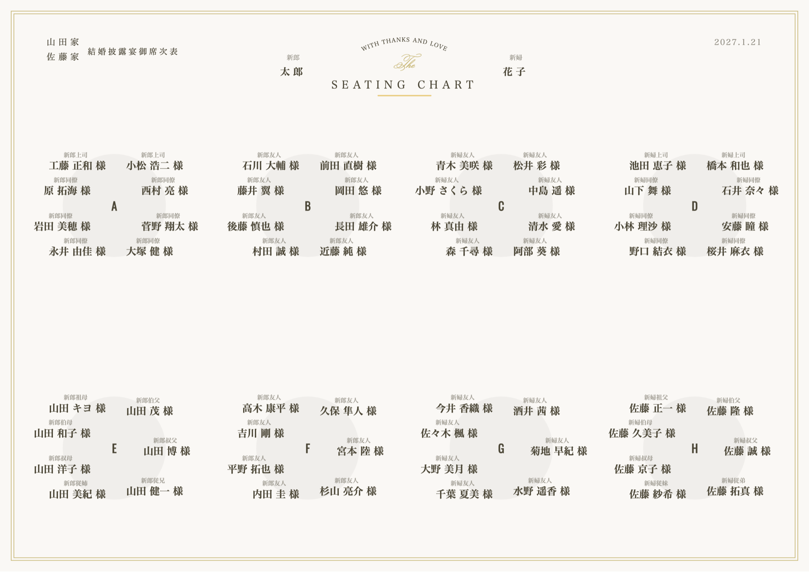
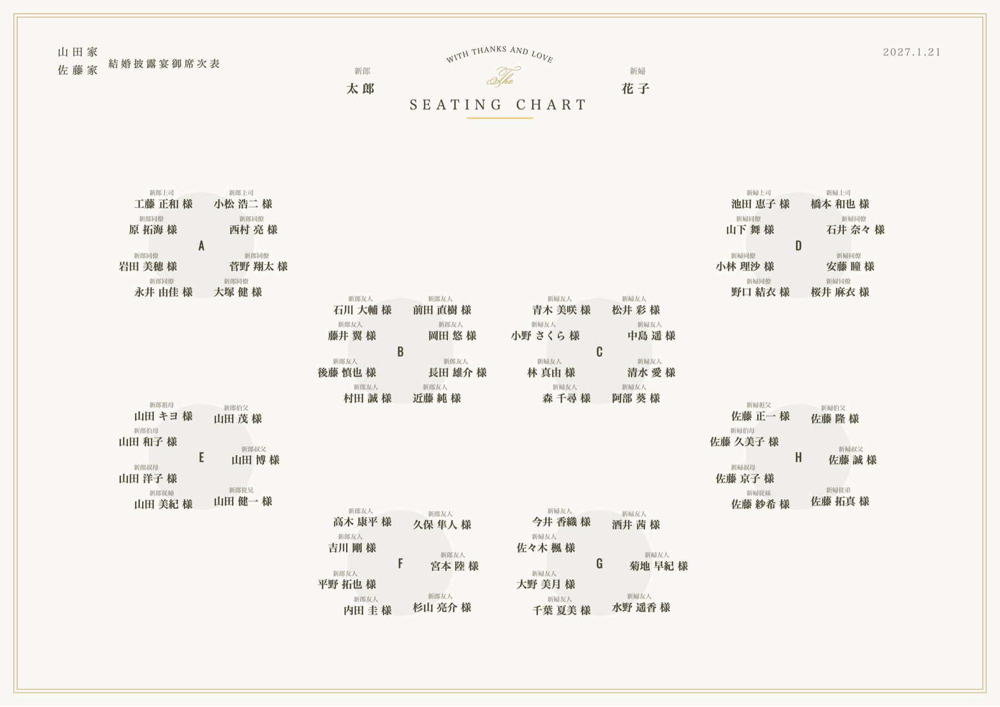
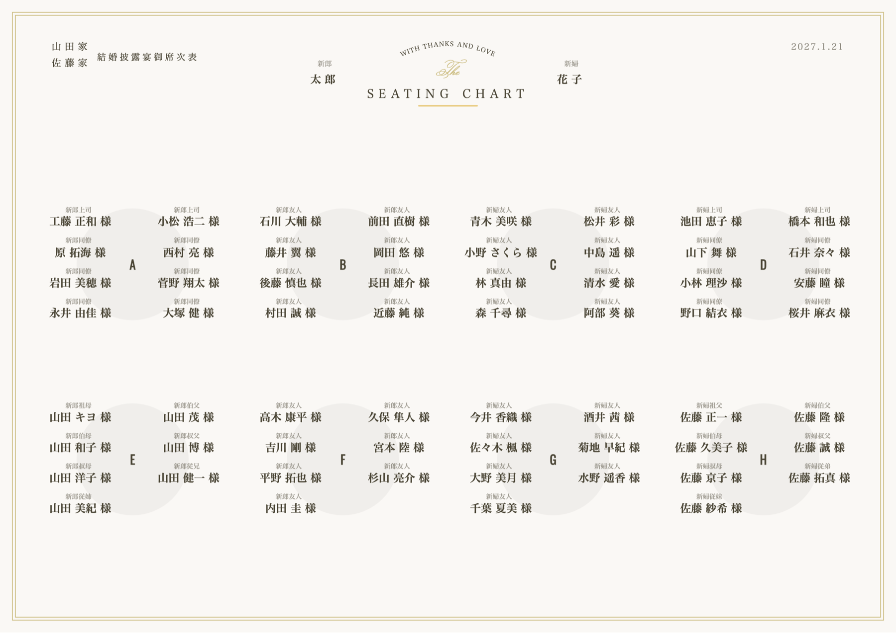
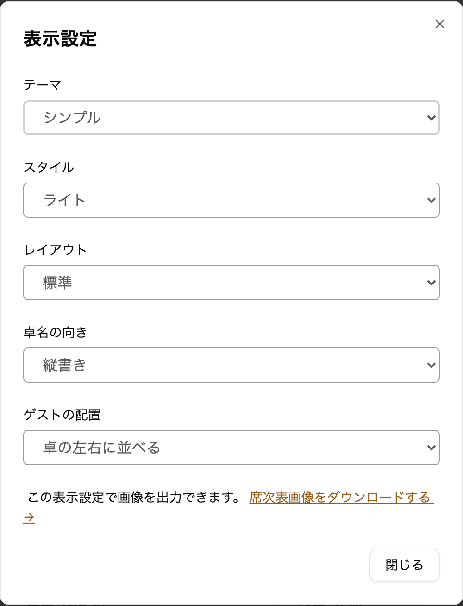

envas をご利用いただき、誠にありがとうございます。

これまで席次表では、ゲストの名前をテーブルの左右に縦に並べて表示していました。このたび、表示設定に「ゲストの配置」を追加し、名前でテーブルのまわりを囲む<strong>「卓を囲む」</strong>を選べるようにしました。

## 完成イメージ

ゲスト 60 名・8 卓（1 卓 7〜8 名）の席次表を「卓を囲む」で作った例です。

レイアウトを「両端ずらし」にすると、次のようになります。

同じ席次表を、これまでどおりの「卓の左右に並べる」で表示すると次のとおりです。

## できること

- 席次表エディタの「表示設定」で、「ゲストの配置」を「卓の左右に並べる」と「卓を囲む」から選べます
- 選んだ配置は、席次表エディタ・ダウンロードする画像・公開ページのすべてに使われます
- 配置を切り替えても、ゲストがテーブルの左右どちらに座るかは変わりません。配席をやり直す必要はありません
- 「卓を囲む」でも、名前は「卓の左右に並べる」とほぼ同じ大きさで表示されます

これまでに作った席次表は「卓の左右に並べる」のままで、見た目は変わりません。表示設定の変更に料金はかかりません。

:::warning[「卓を囲む」をお使いになる前に]
名前を大きく表示するため、名前の一部がテーブルの円や四角に重なることがあります。また、1 つのテーブルに 7 席以上あると、名前がテーブルの上下にはみ出す分だけ、席次表全体が少し小さく表示されることがあります。
:::

## ご利用方法

表示設定の開き方と、席の順番の決まり方はヘルプページをご覧ください。

[https://help.envas.jp/seating-chart/#guest-arrangement](https://help.envas.jp/seating-chart/#guest-arrangement)
