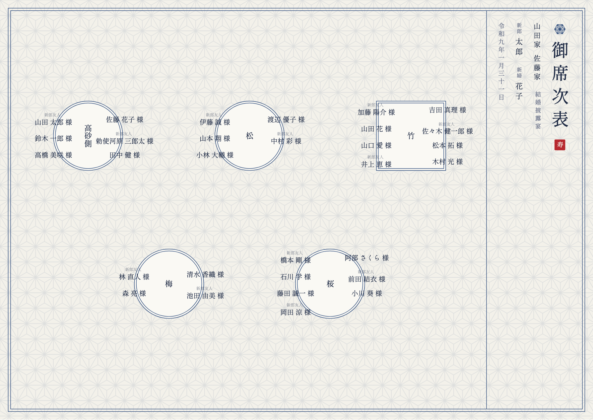
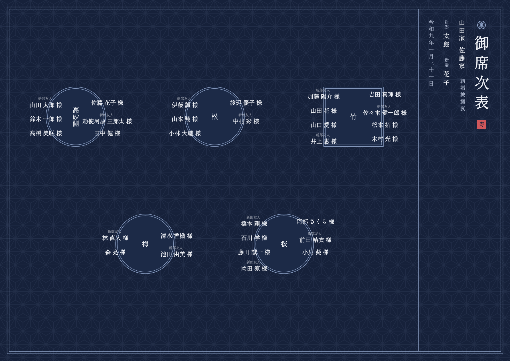
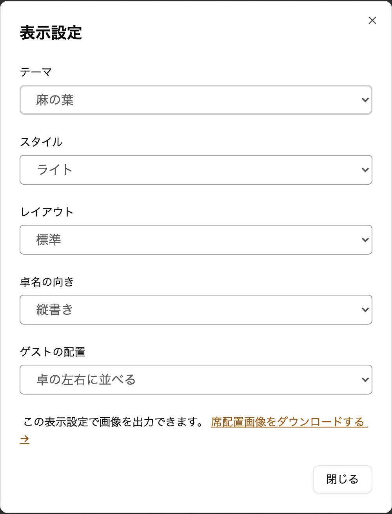

envas をご利用いただき、誠にありがとうございます。

このたび、麻の葉の地紋に縦書きの題字を添えた、藍色の和のテーマ<strong>「麻の葉」</strong>を追加しました。

## 完成イメージ

席次表の右端に見出しを縦書きで置き、麻の葉の紋・「御席次表」の題字・両家のお名前・新郎新婦のお名前・挙式日を右から順に並べます。挙式日は「令和九年一月三十一日」のように漢数字の和暦で表示します。地には麻の葉の柄を薄く敷き、題字に朱色の印を添えています。文字は明朝体です。

見出しを右端に置くため、ほかのテーマより卓を並べる幅が狭くなり、ゲストの名前は少し小さく表示されます。

ライトは、生成りの地に藍色で表示します。

ダークは、藍色の地に白い文字で表示します。

## できること

- 席次表エディタの「表示設定」で、テーマに「麻の葉」を選べます
- 選んだテーマは、席次表エディタ・ダウンロードする画像・公開ページ・プロフィールブックの中の席次表のすべてに使われます
- レイアウト・卓名の向き・ゲストの配置は、麻の葉のテーマでもこれまでどおり選べます
- テーマを切り替えても、配席はそのままです。何度でも切り替えられます
- プロフィールブックのテーマ `wa-tate` や `wa` と組み合わせると、ページ全体を和の雰囲気でそろえられます

これまでに作った席次表の見た目は変わりません。テーマの変更に料金はかかりません。

## ご利用方法

表示設定の開き方とテーマの違いは、ヘルプページをご覧ください。

[https://help.envas.jp/seating-chart/#select-theme](https://help.envas.jp/seating-chart/#select-theme)
