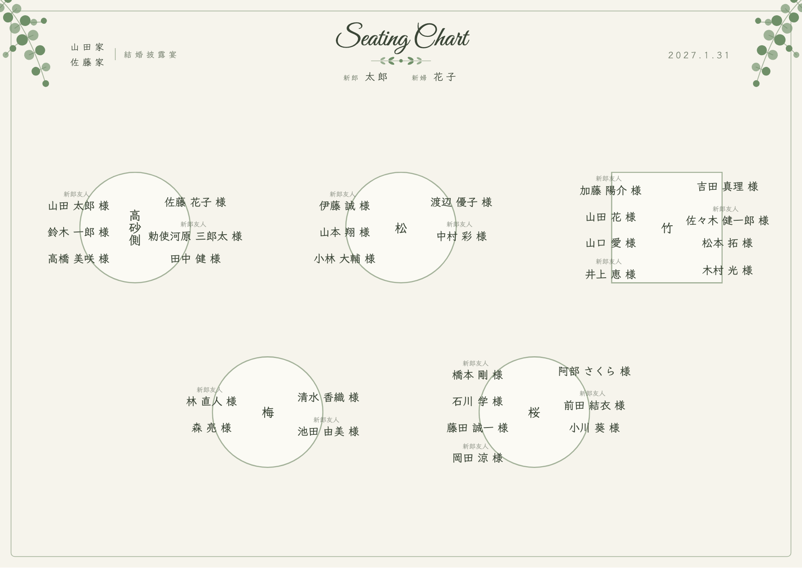
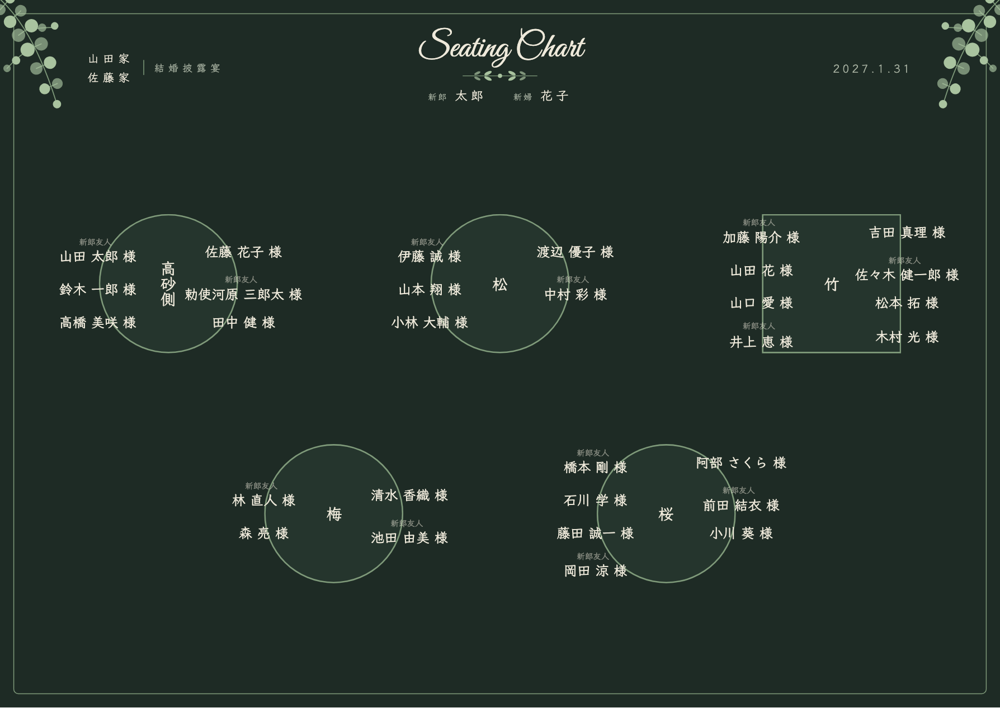
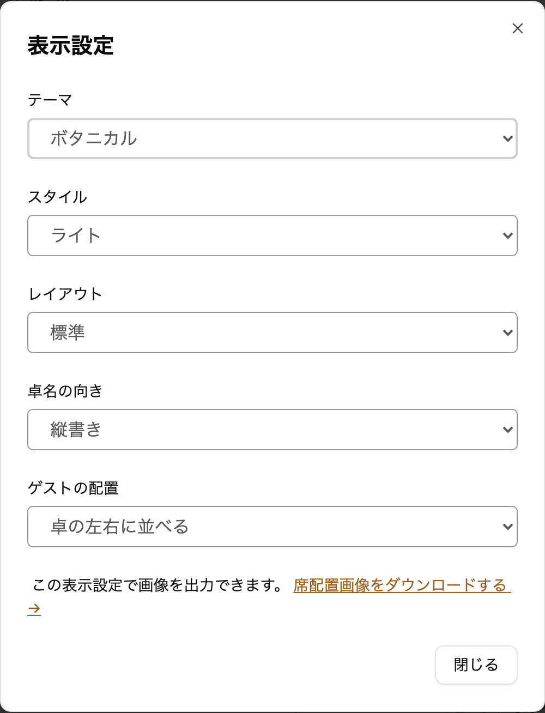

envas をご利用いただき、誠にありがとうございます。

このたび、ガーデンやレストランの披露宴に合わせやすい草花のテーマ<strong>「ボタニカル」</strong>を追加しました。

## 完成イメージ

見出しに筆記体の「Seating Chart」と小枝を置き、見出しの左右にユーカリの枝を添えています。挙式日は「2027.1.31」のように表示します。文字は手書きの風合いの書体です。

ライトは、生成りの地にセージグリーンで表示します。

ダークは、深い緑の地に淡い緑と生成りの色の文字で表示します。

## できること

- 席次表エディタの「表示設定」で、テーマに「ボタニカル」を選べます
- 選んだテーマは、席次表エディタ・ダウンロードする画像・公開ページ・プロフィールブックの中の席次表のすべてに使われます
- レイアウト・卓名の向き・ゲストの配置は、ボタニカルのテーマでもこれまでどおり選べます
- テーマを切り替えても、配席はそのままです。何度でも切り替えられます
- プロフィールブックのテーマ `letter` や `simple` と組み合わせると、ページ全体をやわらかい雰囲気でそろえられます

これまでに作った席次表の見た目は変わりません。テーマの変更に料金はかかりません。

## ご利用方法

表示設定の開き方とテーマの違いは、ヘルプページをご覧ください。

[https://help.envas.jp/seating-chart/#select-theme](https://help.envas.jp/seating-chart/#select-theme)
