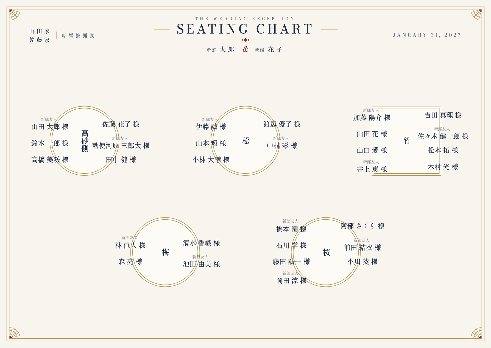
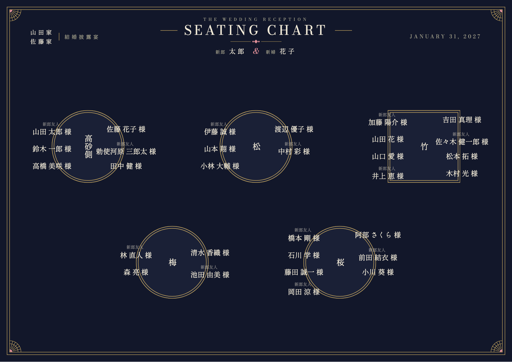
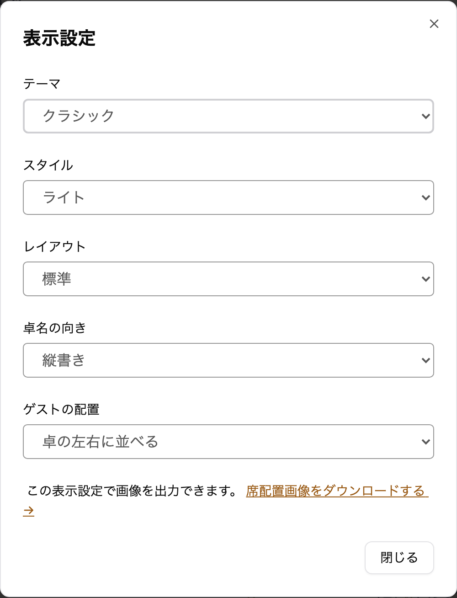

envas をご利用いただき、誠にありがとうございます。

このたび、ホテルなど格式のある会場の洋装の披露宴に合わせやすいテーマ<strong>「クラシック」</strong>を追加しました。

## 完成イメージ

見出しに英字の「SEATING CHART」を置き、挙式日は「January 31, 2027」のように英語で表示します。枠は金の二重線で、四隅に扇の形のアールデコの飾りを添えています。見出しと卓名の英字は細身で上品な欧文の書体、ゲストの名前と卓名の漢字は明朝体です。

ライトは、アイボリーの地にネイビーと金で表示します。

ダークは、濃紺の地に金と生成りの色の文字で表示します。

## できること

- 席次表エディタの「表示設定」で、テーマに「クラシック」を選べます
- 選んだテーマは、席次表エディタ・ダウンロードする画像・公開ページ・プロフィールブックの中の席次表のすべてに使われます
- レイアウト・卓名の向き・ゲストの配置は、クラシックのテーマでもこれまでどおり選べます
- テーマを切り替えても、配席はそのままです。何度でも切り替えられます
- プロフィールブックのテーマ `cool`・`stylish`・`editorial` と組み合わせると、ページ全体を落ち着いた洋の雰囲気でそろえられます

これまでに作った席次表の見た目は変わりません。テーマの変更に料金はかかりません。

## ご利用方法

表示設定の開き方とテーマの違いは、ヘルプページをご覧ください。

[https://help.envas.jp/seating-chart/#select-theme](https://help.envas.jp/seating-chart/#select-theme)
