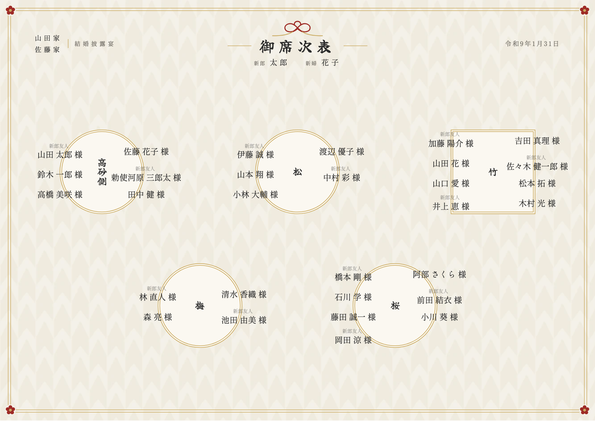
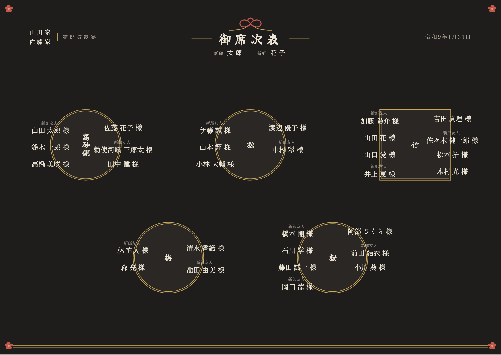
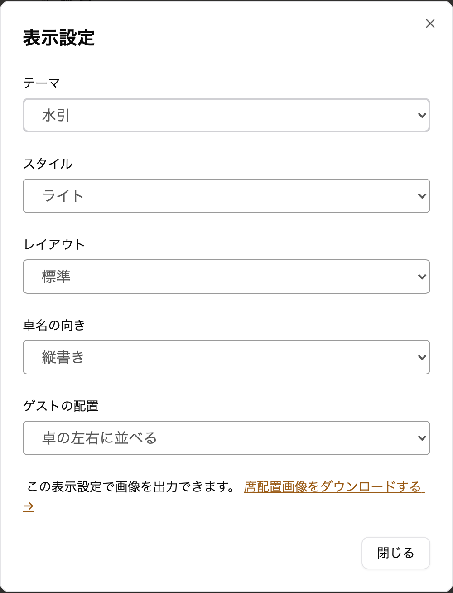

envas をご利用いただき、誠にありがとうございます。

これまで席次表のテーマはシンプルの 1 つだけでした。このたび、和装の披露宴に合わせやすい和モダンのテーマ<strong>「水引」</strong>を追加しました。

## 完成イメージ

見出しに水引の結びと「御席次表」の題字を置き、挙式日は「令和9年1月31日」のように和暦で表示します。枠は金の二重線で、四隅に梅の花を添えています。卓名は筆書きの書体、ゲストの名前は明朝体です。

ライトは、和紙のような地に矢絣の柄を薄く敷いています。

ダークは、墨色の地に金と生成りの色の文字で表示します。

## できること

- 席次表エディタの「表示設定」で、テーマを「シンプル」と「水引」から選べます
- 選んだテーマは、席次表エディタ・ダウンロードする画像・公開ページ・プロフィールブックの中の席次表のすべてに使われます
- レイアウト・卓名の向き・ゲストの配置は、水引のテーマでもこれまでどおり選べます
- テーマを切り替えても、配席はそのままです。何度でも切り替えられます
- プロフィールブックのテーマ `wa` や `wa-tate` と組み合わせると、ページ全体を和の雰囲気でそろえられます

これまでに作った席次表はシンプルのままで、見た目は変わりません。テーマの変更に料金はかかりません。

## ご利用方法

表示設定の開き方とテーマの違いは、ヘルプページをご覧ください。

[https://help.envas.jp/seating-chart/#select-theme](https://help.envas.jp/seating-chart/#select-theme)
