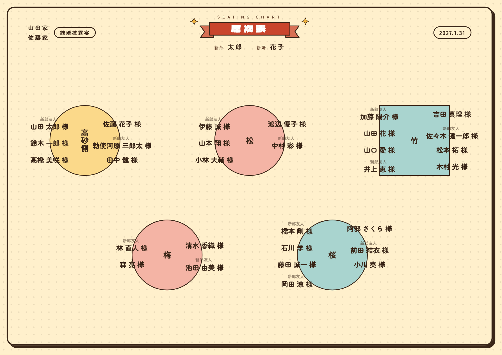
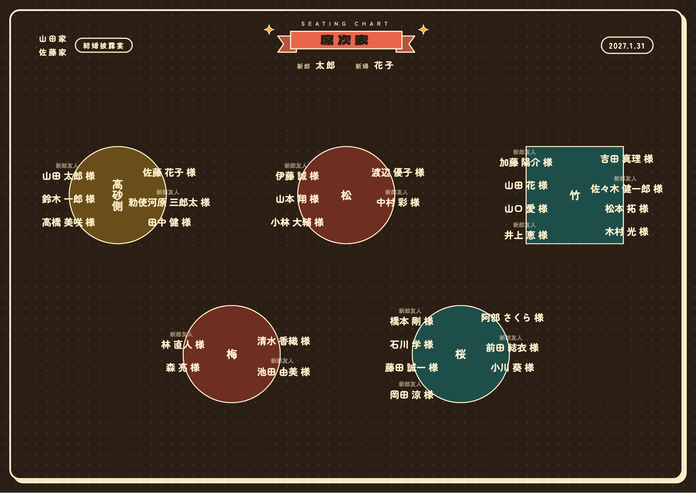
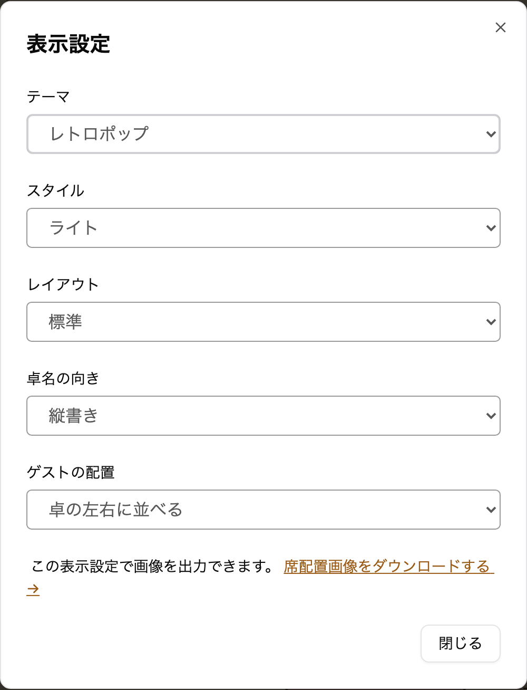

envas をご利用いただき、誠にありがとうございます。

このたび、1.5 次会や二次会などのカジュアルなパーティーに合わせやすいテーマ<strong>「レトロポップ」</strong>を追加しました。

## 完成イメージ

見出しに朱色のリボンを置き、「席次表」の題字を白抜きで表示します。挙式日は「2027.1.31」のように表示します。卓の色はからし色・コーラル・ミントの 3 色を順に使い、地には小さな水玉を敷いています。文字は丸みのあるゴシック体です。

ライトは、バター色の地に焦げ茶と朱色で表示します。

ダークは、焦げ茶の地にクリーム色の文字で表示します。

## できること

- 席次表エディタの「表示設定」で、テーマに「レトロポップ」を選べます
- 選んだテーマは、席次表エディタ・ダウンロードする画像・公開ページ・プロフィールブックの中の席次表のすべてに使われます
- レイアウト・卓名の向き・ゲストの配置は、レトロポップのテーマでもこれまでどおり選べます
- テーマを切り替えても、配席はそのままです。何度でも切り替えられます
- プロフィールブックのテーマ `retro` や `game` と組み合わせると、ページ全体をにぎやかな雰囲気でそろえられます

これまでに作った席次表の見た目は変わりません。テーマの変更に料金はかかりません。

## ご利用方法

表示設定の開き方とテーマの違いは、ヘルプページをご覧ください。

[https://help.envas.jp/seating-chart/#select-theme](https://help.envas.jp/seating-chart/#select-theme)
