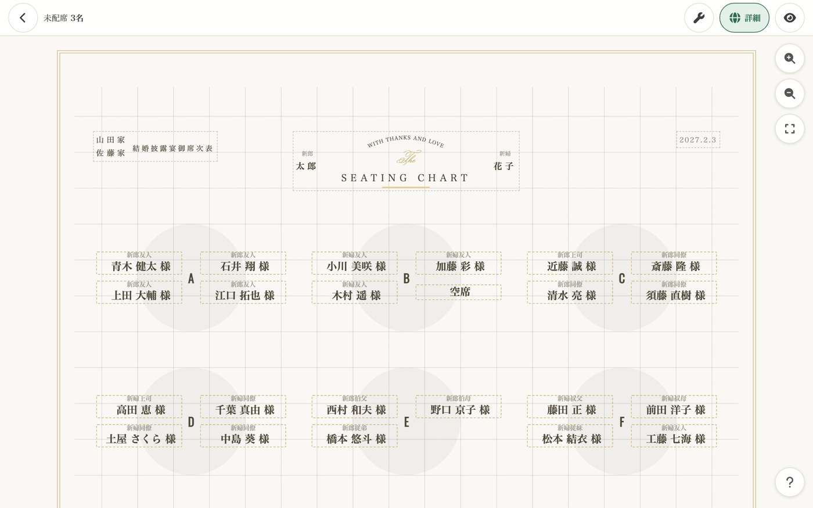
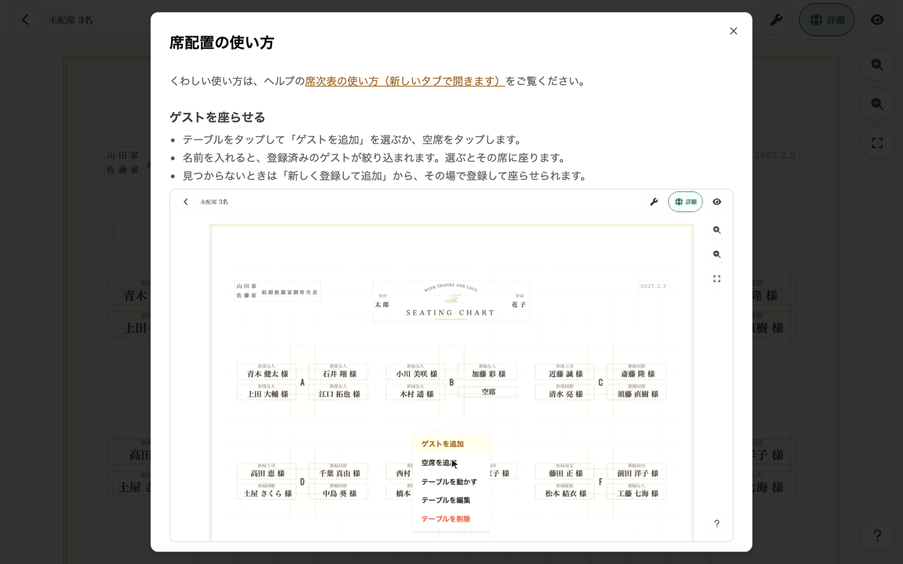

envas をご利用いただき、誠にありがとうございます。

このたび、席次表エディタを新しくしました。テーブルを好きな位置へ動かせるようになり、ゲストを席に座らせる操作もかんたんになりました。

## テーブルを好きな位置に置けます

テーブルは方眼の上に並び、1 マスずつ動かせます。通路を空ける、端のテーブルだけずらすといった、会場に合わせた配置を作れます。

- PC ではテーブルをドラッグして動かします
- スマートフォンではテーブルを長押しして、そのまま指を動かします
- テーブルのメニューの「テーブルを動かす」から、矢印のボタンでも動かせます
- 新郎新婦のお名前や挙式日などの見出しも、同じように動かせます

::video[テーブルをドラッグして、方眼に沿って動かす]{src="/videos/2026-10-27-seating-chart-editor/move-table.v1.mp4" loop}

## ゲストを座らせる操作が 1 つの画面にまとまりました

空席をタップするか、テーブルのメニューの「ゲストを追加」を選ぶと、ゲストを選ぶ画面が開きます。

- 名前を入れると、登録済みのゲストが絞り込まれます
- まだ席に座っていないゲストと、配席済みのゲストが分かれて並びます。配席済みのゲストには、座っているテーブル名が添えられます
- 見つからないゲストは、その場で新しく登録して座らせられます

::video[テーブルのメニューの「ゲストを追加」から、名前で探して座らせる]{src="/videos/2026-10-27-seating-chart-editor/guest-picker.v1.mp4" loop}

スマートフォンでも同じように操作できます。

::video[スマートフォンで空席にゲストを座らせ、テーブルを長押しして動かす]{src="/videos/2026-10-27-seating-chart-editor/mobile.v1.mp4" loop}

## 使い方をいつでも確認できます

席次表エディタの右下の「？」をタップすると、操作ごとの短い動画が付いた使い方が開きます。

## 変わったこと

- 左側（スマートフォンでは下）のゲスト一覧のパネルはなくなりました。まだ席に座っていないゲストの人数は、画面の左上に表示されます
- 表示設定の「レイアウト（標準・両端ずらし）」はなくなりました。これまでに作った席次表は、選んでいたレイアウトの並びのまま表示されます

新しい席次表エディタのご利用に料金はかかりません。

## ご利用方法

操作の詳しい手順は、ヘルプページをご覧ください。

[https://help.envas.jp/seating-chart/](https://help.envas.jp/seating-chart/)
