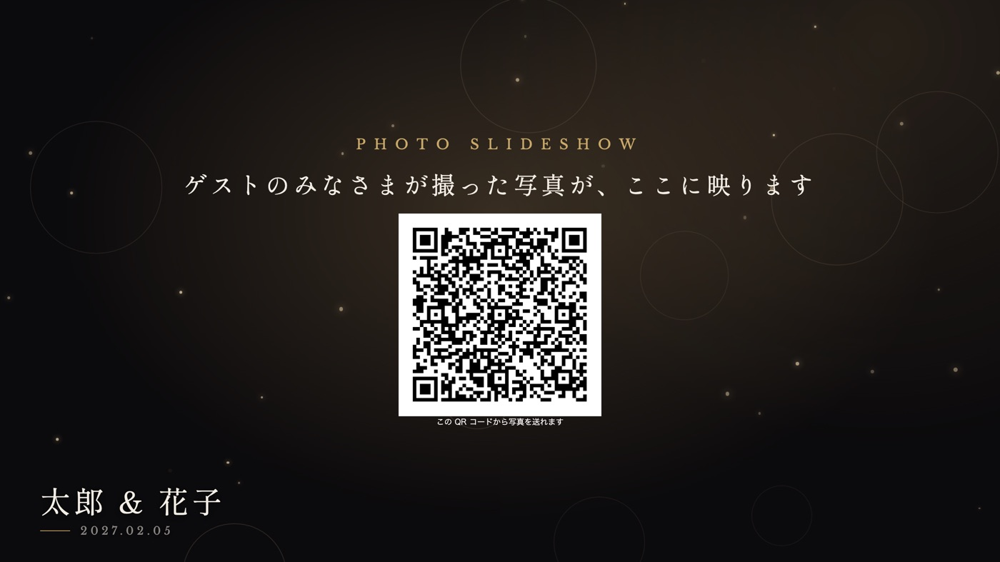
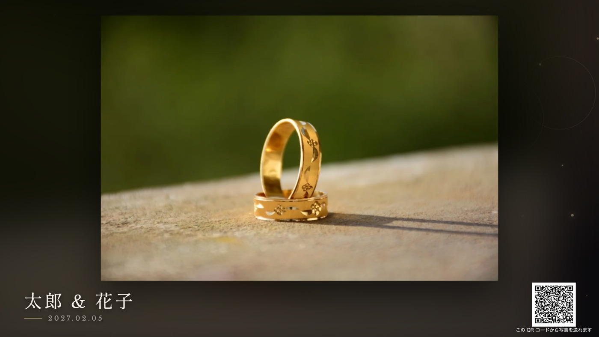

envas をご利用いただき、誠にありがとうございます。

このたび、スライドショーの会場の画面に、ゲストが写真を送るための QR コードが出るようになりました。スクリーンを見たゲストがその場でスマートフォンで読み取り、写真を送れます。受付や席札の QR コードを見逃したゲストからも写真が届き、上映中にもスライドショーの写真が増えていきます。

## できること

- 写真がまだ 1 枚も届いていないときは、会場の画面の中央に QR コードが大きく出ます。披露宴が始まる前から、ゲストに写真を送ってもらえます
- 写真が流れているあいだは、会場の画面の右下に QR コードが小さく出ます
- 右下の QR コードは、スライドショーの画面の「見た目を選ぶ」で「出さない」を選ぶと消せます。上映中に選び替えても、数秒で会場の画面に反映されます
- 写真共有の画面で URL を作り直したときは、会場の画面の QR コードも数秒で新しい QR コードに替わります。会場の画面を開き直す必要はありません

QR コードの中身は、写真共有でゲストに配る QR コードと同じです。賞の発表のあいだと、ご購入の前のサンプルには QR コードは出ません。

## 料金

追加の料金はかかりません。スライドショーをご購入済みの挙式では、そのまま会場の画面に QR コードが出ます。

## ご利用方法

QR コードが出る場所と消し方は、ヘルプページをご覧ください。

[https://help.envas.jp/guest-photo-slideshow/#screen-qr](https://help.envas.jp/guest-photo-slideshow/#screen-qr)
