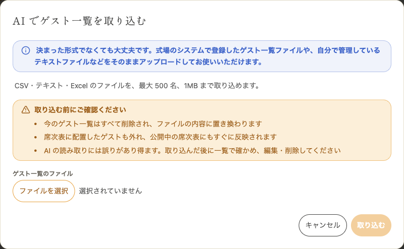
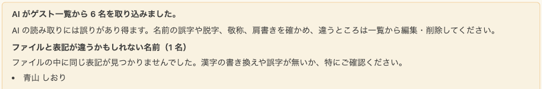

envas をご利用いただき、誠にありがとうございます。

このたび、ゲスト一覧の画面に「AI で取り込む」が加わりました。決まった形式でなくても大丈夫です。式場のシステムで登録したゲスト一覧ファイルや、ご自身で管理しているテキストファイルなどをそのままアップロードすると、AI がお名前・敬称・肩書きを読み取ってゲスト一覧に登録します。ゲストを一人ずつ入力する手間がなくなります。

## できること

- CSV・TSV・テキスト・Excel のファイルを、1MB まで、ゲスト 500 名まで取り込めます
- 列の並びや見出しが決まっていなくても、AI がお名前・敬称・肩書きを読み取ります。肩書きは「新郎 友人」「新婦 株式会社サンプル 部長」のように、新郎側・新婦側と関係をつないで登録します
- 取り込みには数十秒から数分かかります。画面を離れても取り込みは続きます
- 取り込んだ後は、ファイルと表記が違うかもしれないお名前が案内に並びます。誤字や漢字の書き換えが無いかをご確認ください

:::warning[今のゲスト一覧は置き換わります]
AI で取り込むと、今のゲスト一覧はすべて削除され、ファイルから読み取ったゲストに置き換わります。席次表に配置したゲストも外れ、公開中の席次表にもすぐに反映されます。AI の読み取りには誤りがあり得るので、取り込んだ後は一覧で確かめ、必要に応じて編集・削除してください。
:::

## 料金

無料でお使いいただけます。取り込みは、同じ挙式で 5 分に 1 回までです。

## ご利用方法

取り込みの手順と、取り込んだ後に確かめることは、ヘルプページをご覧ください。

[https://help.envas.jp/guest/#import-guests-ai](https://help.envas.jp/guest/#import-guests-ai)
