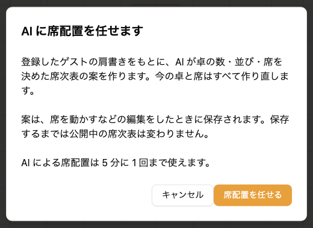
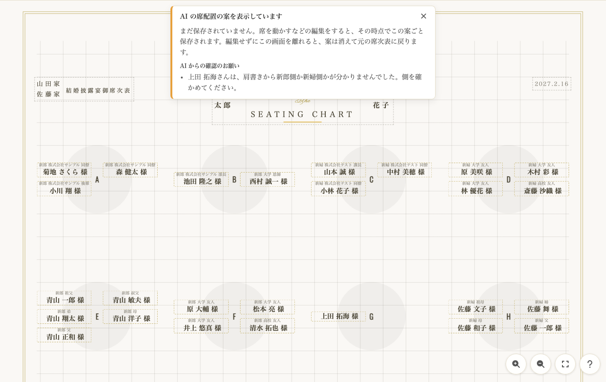

envas をご利用いただき、誠にありがとうございます。

このたび、席次表の編集画面に「AI 配席」が加わりました。登録したゲストの肩書きをもとに、AI が卓の数・並び・どのゲストがどの卓に座るかを決めて、席次表のたたき台を作ります。席の配置をいちから考える手間が減り、できた案を直すだけで席次表を仕上げられます。

## できること

- 日本の結婚式の慣例に沿って並べます。高砂に近い列の中央を上座に、職場の上司や恩師の卓を置き、親族の卓は後ろの列の端に置きます。新郎側のゲストは向かって左、新婦側のゲストは右に分けます
- テーブルは列ごとに横に広く並べ、名前は A、B、C… と付きます
- 欠席のゲストは席に入りません。出欠が未定のゲストは席に入ります
- 新郎側か新婦側かが分からないゲストなど、AI が判断に迷った席は、案内にお名前が並びます
- 案は、席を動かすなどの編集をしたときに保存されます。保存するまでは、公開中の席次表は変わりません

ゲストの肩書きに「新郎 株式会社サンプル 部長」「新婦 大学 友人」のように、新郎側・新婦側と関係が入っていると、慣例に沿った案になりやすくなります。[ゲスト一覧を AI で取り込む](/news/2026-11-08-guest-list-ai-import/)と、肩書きがこの形で登録されます。

:::warning[今の卓と席は作り直されます]
AI に席配置を任せると、今のテーブルと席はすべて作り直されます。案を編集すると、その時点で今の席次表が案に置き換わります。AI の案には誤りがあり得るので、ゲストの席と並びを確かめてから仕上げてください。
:::

## 料金

無料でお使いいただけます。AI 配席は、同じ挙式で 5 分に 1 回まで、出席するゲスト 500 名までです。

## ご利用方法

頼む手順と、案を確かめて保存する方法は、ヘルプページをご覧ください。

[https://help.envas.jp/seating-chart/#ai-arrangement](https://help.envas.jp/seating-chart/#ai-arrangement)
