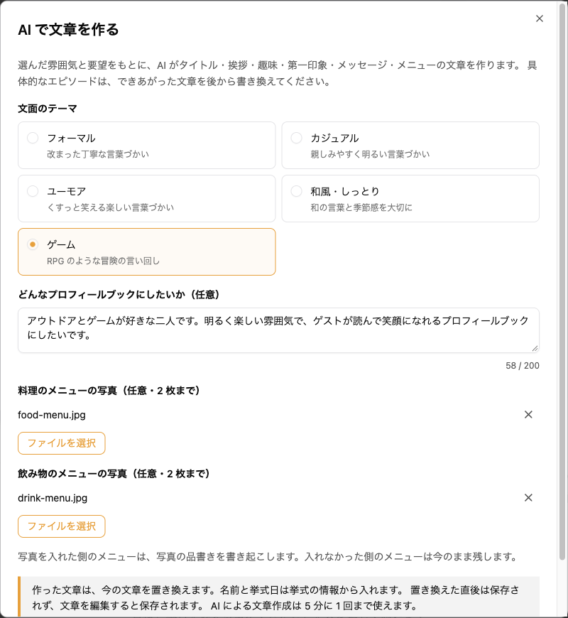
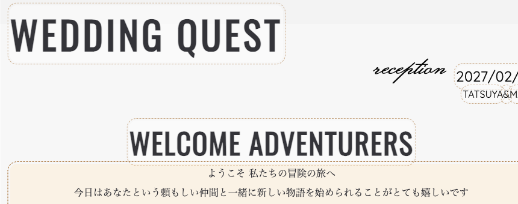
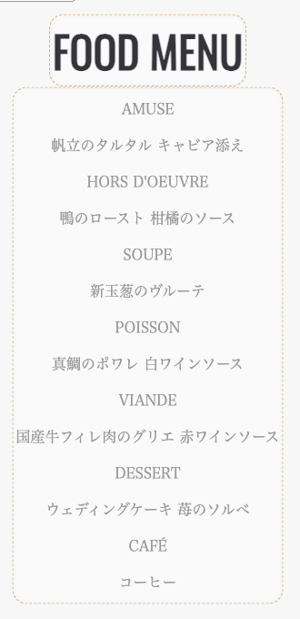

envas をご利用いただき、誠にありがとうございます。

このたび、プロフィールブックの編集画面に「AI 文章」が加わりました。文面のテーマを選び、どんなプロフィールブックにしたいかを書くと、AI がプロフィールブックの文章をまとめて作ります。文章をいちから考える手間が減り、できた文章をお二人の言葉に直すだけでプロフィールブックを仕上げられます。

## できること

- 文面のテーマは「フォーマル」「カジュアル」「ユーモア」「和風・しっとり」「ゲーム」の 5 つから選べます。デザインのテーマとは別に選べます
- AI が作るのは、タイトル、ごあいさつ、新郎・新婦それぞれの趣味・第一印象・メッセージ、皆様へのメッセージなどの文章です。見出しは、選んでいるデザインのテーマに合わせた書き方になります
- お名前と挙式日は、挙式の情報から入ります
- 料理と飲み物のメニュー表の写真を添えると、写真に書かれた品書きを 1 行 1 品で書き起こします。写真はそれぞれ 2 枚まで選べます
- 忌み言葉や句読点を避けるよう、結婚式の文章の決まりに沿って作ります
- 作った文章は、編集すると保存されます。置き換える前の文章には、元に戻すボタンで戻せます

趣味や第一印象のような欄も、要望から想像した例文で埋めます。具体的なエピソードは、できあがった文章をお二人の言葉に書き換えてください。

:::warning[今の文章は置き換わります]
AI が作った文章は、ご自身で入力した文章も含めて、対象の欄を置き換えます。AI の文章には誤りがあり得るので、公開する前に読み直してください。
:::

## 料金

無料でお使いいただけます。AI による文章作成は、同じ挙式で 5 分に 1 回までです。

## ご利用方法

頼む手順と、作った文章を確かめる方法は、ヘルプページをご覧ください。

[https://help.envas.jp/profile-book-writing/](https://help.envas.jp/profile-book-writing/)
