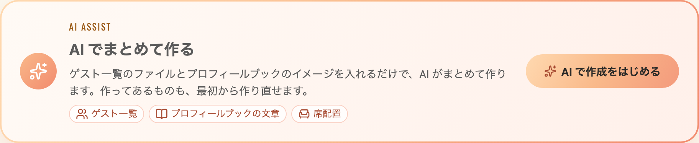
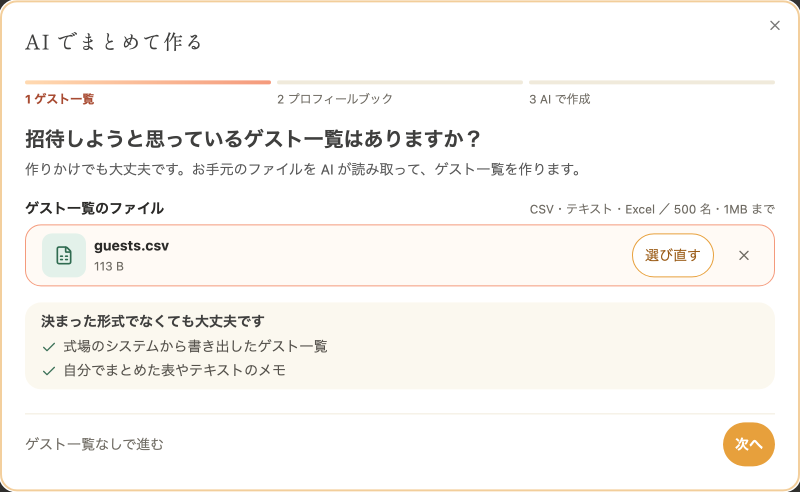
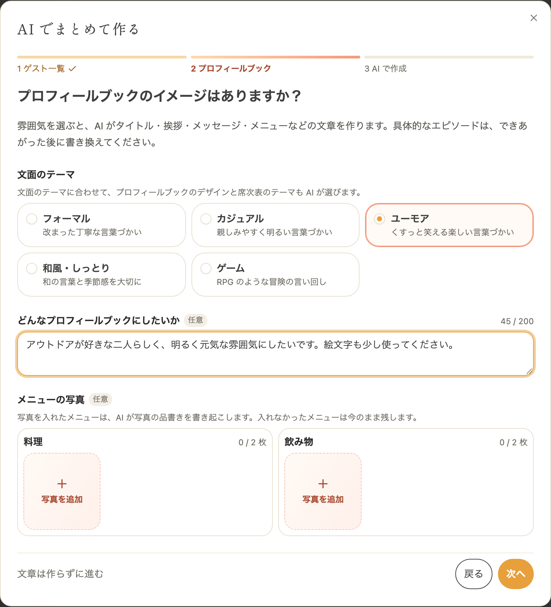
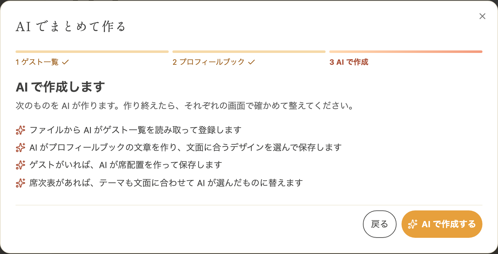

envas をご利用いただき、誠にありがとうございます。

このたび、ダッシュボードに「AI でまとめて作る」が加わりました。ゲスト一覧のファイルとプロフィールブックのイメージを入れるだけで、AI がゲスト一覧、プロフィールブックの文章、席配置を順に作ります。これまで別々の画面で頼んでいた[ゲスト一覧の取り込み](/news/2026-11-08-guest-list-ai-import/)・[席配置](/news/2026-11-09-seating-chart-ai-arrangement/)・[プロフィールブックの文章作成](/news/2026-11-12-profile-book-ai-writing/)を、1 つの流れでお使いいただけます。

あわせて、プロフィールブックの文章作成では、文面に合うデザインと席次表のテーマも AI が選ぶようになりました。

## AI でまとめて作る

ダッシュボードの「AI で作成をはじめる」を押し、3 つの手順で進みます。

1. ゲスト一覧のファイルを選びます。式場のシステムから書き出したゲスト一覧や、ご自身でまとめた表やテキストのメモなど、決まった形式でなくても大丈夫です
2. プロフィールブックの文面のテーマと、どんなプロフィールブックにしたいかを入れます。料理と飲み物のメニュー表の写真も添えられます
3. AI が作るものを確かめて、「AI で作成する」を押します

ゲスト一覧のファイルがまだ無いときや、文章をまだ作らないときは、その手順を飛ばせます。席配置は、取り込んだゲスト一覧をもとに AI が作ります。ゲスト一覧の手順を飛ばしたときは、席次表がまだ無ければ、登録済みのゲストで席配置を作ります。

作り終えたら「プロフィールブックを確認する」を押すと、プロフィールブックの編集画面に移ります。できあがった内容を確かめて、お二人の言葉に整えてください。

### まだ作っていないものがあるときは、自動で開きます

挙式を作った直後など、ゲスト・プロフィールブック・席次表のどれかがまだ無いときは、ダッシュボードを開くと「AI でまとめて作る」が自動で開きます。このときは作ってあるものを作り直さず、まだ無いものだけを作ります。

ダッシュボードの「AI で作成をはじめる」から開いたときは、作ってあるものも最初から作り直せます。今のデータが置き換わるときは、作成の前にお知らせします。

## プロフィールブックの文章作成で変わったこと

ダッシュボードの「AI でまとめて作る」でも、プロフィールブックの編集画面の「AI 文章」でも、次のように変わりました。

- 文面のテーマと要望に合わせて、プロフィールブックのデザインと席次表のテーマも AI が選びます
- お二人の呼び名と名前のローマ字も、挙式の情報のお名前から AI が書きます。呼び名は、選んだデザインに合わせた書き方になります。漢字の読みは AI の推測なので、読み方が合っているかを確かめてください
- 「どんなプロフィールブックにしたいか」に「絵文字多めで大丈夫」のように書くと、絵文字を使った文章になります

プロフィールブックの文章とデザインは、編集画面の元に戻すボタンで前に戻せます。席次表のテーマは元に戻すボタンでは戻らないので、変えたいときは席配置編集の表示設定から選び直してください。

## AI 文章と AI 配席は、すぐに保存されるようになりました

これまで、編集画面の「AI 文章」と「AI 配席」で作った内容は、次に編集したときに保存されていました。今後は、AI が作り終えるとすぐに保存され、公開中の席次表＆プロフィールブックにもすぐに反映されます。頼む前の確認で、置き換わるものと公開中への反映をお知らせします。

:::warning[今のデータは置き換わります]
ゲスト一覧を取り込むと、今のゲスト一覧はすべて置き換わります。文章を作ると、今の文章とデザインが置き換わります。席配置を作ると、今の卓と席は作り直されます。どれも公開中の席次表＆プロフィールブックにすぐに反映されます。AI が作った内容には誤りがあり得るので、作った後は必ず確かめてください。
:::

:::warning[作成中はタブを閉じないでください]
作り終えるまで、5 分ほどかかることがあります。作成中にタブを閉じたりほかの画面に移ったりすると、作った内容が反映されないことがあります。
:::

## 料金

無料でお使いいただけます。ゲスト一覧の取り込み・文章作成・席配置は、それぞれ同じ挙式で 5 分に 1 回までです。どれかを使ってから 5 分たつまでと、作成中のあいだは「AI で作成をはじめる」を押せません。待っているあいだは、ボタンの下に次に使える時刻が表示されます。

## ご利用方法

それぞれの AI 機能の使い方は、ヘルプページをご覧ください。

- ゲスト一覧の取り込み [https://help.envas.jp/guest/#import-guests-ai](https://help.envas.jp/guest/#import-guests-ai)
- プロフィールブックの文章作成 [https://help.envas.jp/profile-book-writing/](https://help.envas.jp/profile-book-writing/)
- 席配置 [https://help.envas.jp/seating-chart/#ai-arrangement](https://help.envas.jp/seating-chart/#ai-arrangement)
